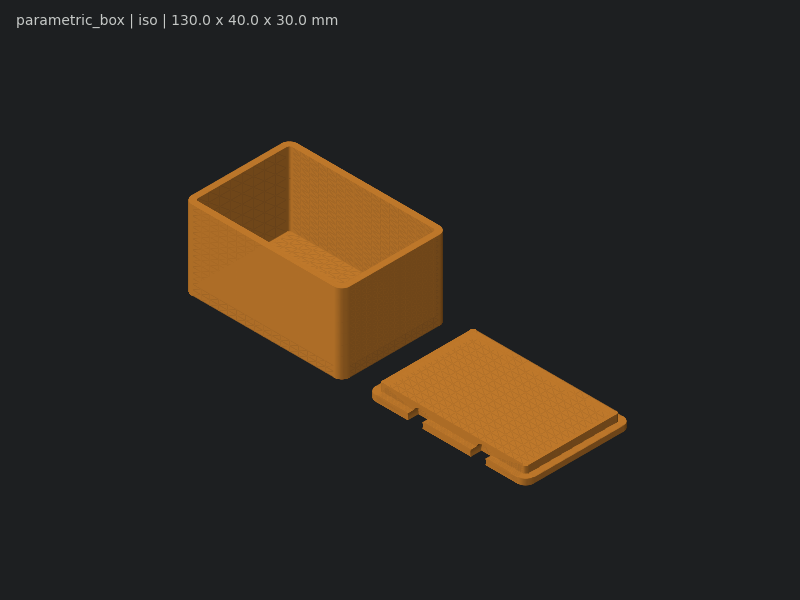

# LAS FreeCAD Skill

An agent skill that lets Claude Code (or any agent that reads `SKILL.md` files) design
3D-printable parts in **FreeCAD**, fully headless: write a parametric Python model, check that it
is a valid closed solid, look at it from six angles, and export STL, 3MF, OBJ or STEP.

No FreeCAD window opens and nothing extra is installed. It only needs FreeCAD 1.0 or newer.



## Install

```bash
git clone https://github.com/lia-arch/las-freecad-skill.git
cp -R las-freecad-skill/skills/freecad ~/.claude/skills/freecad
```

Then ask Claude for a part, for example: *"Design a 60 x 40 mm box with a snap-on lid for my
printer."* The skill makes Claude validate and visually check every model before handing it over.

## Requirements

- FreeCAD 1.0+ from https://www.freecad.org/downloads.php (macOS, Linux; Windows needs bash,
  e.g. Git Bash or WSL).
- The tools find `freecadcmd` on `PATH` or in `/Applications/FreeCAD.app`. Set
  `FREECADCMD=/path/to/freecadcmd` if yours lives elsewhere.
- Preview images use the matplotlib bundled with FreeCAD's Python (included in the official
  builds). Without it, everything except previews still works.

## Tools

| Tool | What it does |
|---|---|
| `tools/validate.sh model.py` | Builds the model, checks for valid closed solids, prints size and volume |
| `tools/multi-preview.sh model.py dir/` | Renders iso, front, back, left, right and top PNGs |
| `tools/preview.sh model.py out.png --view top` | Renders one view |
| `tools/extract-params.sh model.py [--json]` | Lists parameters without running the model |
| `tools/export.sh model.py out.3mf -D width=80` | Exports `.stl .3mf .obj .step .stp .brep` |
| `tools/render-with-params.sh model.py out.stl p.json` | Exports with parameters from a JSON file |

Models are plain Python: parameters at the top with OpenSCAD-style customizer comments
(`# [min:max] Description`), and a `build()` function returning a `Part.Shape`. See
[`skills/freecad/examples/`](skills/freecad/examples/).

## Safety

A model is Python code and runs with your user's permissions. Only run models you wrote or
trust. Parameter overrides (`-D name=value`) are parsed as literals and never executed.

## License

Apache License 2.0. The look-before-you-deliver workflow was inspired by the `openscad` skill in
[mitsuhiko/agent-stuff](https://github.com/mitsuhiko/agent-stuff). Everything here was written
new for FreeCAD; see [NOTICE](NOTICE).
